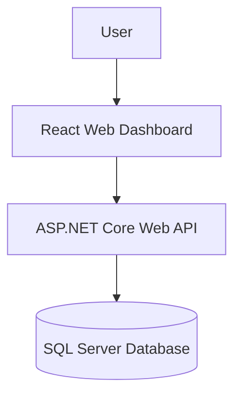

# City Cafe Management System

A modern cafe management system designed to streamline daily cafe operations, manage products and categories, process customer orders, and organize invoices through an intuitive dashboard.

---

## Overview

**City Cafe Management System** is a web-based management application built to simplify and organize cafe operations. It provides a centralized platform for managing cafe data and daily transactions through a clean, structured, and user-friendly interface.

The system is designed to support different user roles, such as administrators and cashiers, with the goal of improving operational efficiency, minimizing manual work, and providing a more organized workflow.

---

## Features

- **Authentication** — Secure login system for authorized users.
- **User Management** — Manage system users and their roles.
- **Category Management** — Organize cafe products into categories.
- **Product Management** — Manage products and their information.
- **Invoice Management** — Create and manage sales invoices.
- **Dashboard** — A centralized interface for accessing system modules.
- **Role-Based Access** — Different access levels for system users.

---

## Tech Stack

### Frontend

| Technology   | Purpose                         |
| ------------ | ------------------------------- |
| React        | UI development                  |
| Vite         | Development server & build tool |
| JavaScript   | Application logic               |
| React Router | Client-side routing             |
| CSS          | Styling and responsive UI       |

### Backend

| Technology           | Purpose                        |
| -------------------- | ------------------------------ |
| ASP.NET Core Web API | Backend services and REST APIs |
| C#                   | Backend development language   |

### Database

| Technology           | Purpose                        |
| -------------------- | ------------------------------ |
| Microsoft SQL Server | Relational database management |

---

## Architecture

The project follows a client-server architecture, separating the frontend application, backend services, and database.



- **Frontend:** Handles the user interface, navigation, and user interactions.
- **Backend:** Handles business logic, validation, authentication, and API requests.
- **Database:** Stores and manages application data.

---

## Project Modules

| Module         | Description                            |
| -------------- | -------------------------------------- |
| Authentication | User login and access control          |
| Dashboard      | Main navigation and system overview    |
| Categories     | Managing product categories            |
| Products       | Managing cafe products                 |
| Invoices       | Handling sales and invoice operations  |
| Users          | Managing employees and system accounts |

---

## Getting Started

### Prerequisites

Make sure you have the following installed:

- [Node.js](https://nodejs.org/)
- npm
- [.NET SDK](https://dotnet.microsoft.com/download)
- [Microsoft SQL Server](https://www.microsoft.com/en-us/sql-server)
- [Git](https://git-scm.com/)

### 1. Clone the repository

```bash
git clone https://github.com/YOUR_USERNAME/city-cafe.git
```

### 2. Navigate to the frontend directory

```bash
cd city-cafe
```

### 3. Install dependencies

```bash
npm install
```

### 4. Start the development server

```bash
npm run dev
```

The frontend application will be available at the local URL provided by Vite, usually:

```text
http://localhost:5173
```

### 5. Run the backend

Open the backend solution in Visual Studio or your preferred .NET IDE, configure the database connection string, and run the ASP.NET Core Web API project.

> Backend and database setup instructions will be expanded as the backend implementation progresses.

---

## Roadmap

- [x] Project initialization
- [x] Frontend setup with React and Vite
- [x] Initial dashboard layout
- [x] Reusable common components
- [ ] Authentication & authorization
- [ ] Category management
- [ ] Product management
- [ ] Invoice & sales management
- [ ] Backend API integration
- [ ] Database integration
- [ ] Role and permission management
- [ ] Dashboard analytics
- [ ] Testing and final improvements

---

## User Roles

The system is intended to support different roles with different responsibilities.

| Role            | Responsibilities                                                    |
| --------------- | ------------------------------------------------------------------- |
| Admin / Manager | Manage products, categories, users, invoices, and system operations |
| Cashier         | Handle daily sales and invoice operations                           |

_Permissions and role restrictions will be implemented as the system evolves._

---

## Project Goals

- Digitize daily cafe operations.
- Simplify sales and invoice management.
- Organize products and categories.
- Provide a maintainable and scalable software structure.
- Apply practical software engineering principles.
- Deliver an intuitive and efficient user experience.

---

## Development

This project is being developed with a focus on:

- Clean and maintainable code.
- Separation of concerns.
- Reusable components.
- Scalable project architecture.
- Consistent UI/UX.
- Practical application of frontend and backend development concepts.

---

## License

This project was developed for educational purposes as a graduation project.

---

<p align="center">
  Made with ☕ for <strong>City Cafe</strong>
</p>
